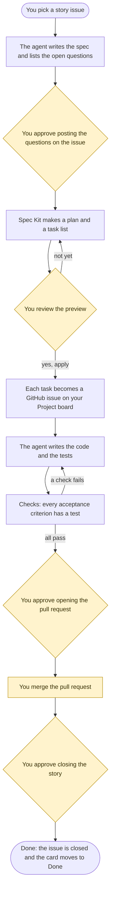

# spec-kit-ghp

**Your AI agent does the GitHub Projects grunt work. You press yes.**

> [!NOTE]
> **GitHub Projects (v2) and GitHub Issues only.** A community project, not an official GitHub product.
> This is an early release (0.1). Every command below works, but some parts have not yet been tried on real GitHub, and those are labelled unverified.
> See [What works today](#what-works-today) and [Trust and limits](docs/trust-and-limits.md).

<div align="center">

[](https://github.com/praveenlavu/spec-kit-ghp/actions/workflows/ci.yml)
[](LICENSE)
[](https://www.python.org/)
[](https://github.com/github/spec-kit)

**[Quick setup](#quick-setup)** · **[How to use it](#how-to-use-it)** · **[Troubleshooting](#if-something-goes-wrong)** · **[Quickstart guide](docs/quickstart.md)** · **[Glossary](docs/glossary.md)**

</div>

spec-kit-ghp is an add-on for [Spec Kit](https://github.com/github/spec-kit), a toolkit that has your AI coding agent agree a written spec and plan with you before it writes any code.
It connects that agent to your GitHub issues and your Project board, so the right questions get asked up front and the grunt work of planning, coding and testing gets done for you.
Nothing on GitHub changes until you have seen the exact change and said yes, which leaves your time for the questions, the tangents worth exploring and the decisions.

## Why you'll like it

- ✅ **Proof, not promises.** Every acceptance criterion (a line saying what "done" means) is tied to a test that proves it, in one checklist file per story.
- 🛑 **Nothing happens behind your back.** New issues, comments, card moves and pull requests are shown first and written only after you say yes.
- 💬 **The right questions get asked up front.** The agent lists what is unclear in the story, you approve what is posted on the issue, and the answers come back into the plan.
- 🧩 **Works with your stack.** It uses whatever Spec Kit setup you already have, for any language.
- 🔒 **Your token stays with `gh`.** `ghp` never reads your token: the GitHub CLI signs in and makes each call.

## How it works

From story to open pull request, the agent does the grunt work. You decide at the yellow steps.



The yellow shapes are yours: the diamonds are your decisions, and you merge the pull request. `ghp` may read from GitHub at any time.
It writes only after you approve.
The agent's part ends at the open pull request. Your team reviews and merges it, and then the `done` step closes the story and moves the card to Done, after your yes (if you turned on the optional link-on-merge workflow, a GitHub Actions workflow that runs `done` after a merge into the default branch, the merge itself is the approval there).

**How this differs from doing it by hand.** You can do every one of these steps yourself in GitHub's web pages or with `gh`: create each sub-issue, add it to the board, set its column, open the pull request, close the story. `ghp` makes the same calls through `gh`. What it adds is that each change is shown first as one preview, only that preview is applied after your yes, and a saved preview is refused if anything changed since. It also keeps one checklist file per story that ties each acceptance criterion to its test. It has no web interface of its own.

## Quick setup

You need:

- Python 3.9 or later, and `git`.
- The GitHub CLI, [`gh`](https://cli.github.com/), signed in.
- A Spec Kit project (a folder where you ran `specify init`).
- A GitHub Project (a board of cards) owned by your user account, and a repository for the issues.
- A story issue in that repository: the issue that describes one piece of work. Its tasks become sub-issues (issues under it).

**1. Sign in to GitHub with `gh`.** `ghp` uses `gh` for every call. The `project` scope (a permission) lets it read and update your board.

```bash
gh auth login --scopes project
```

**2. Install `ghp`.**

```bash
pipx install git+https://github.com/praveenlavu/spec-kit-ghp.git@v0.1.1
ghp --version
```

No `pipx`? Use `python3 -m pip install --user git+https://github.com/praveenlavu/spec-kit-ghp.git@v0.1.1` instead.
Both lines install the 0.1.1 release. The `v0.1.1` tag is created when 0.1.1 is released; until then these lines do not work.

**3. Tell `ghp` where your issues and board live.** In your Spec Kit project, run `ghp setup` and answer its questions. It asks for no password or token, and it writes `ghp.config.json` for you. Or create the file by hand:

```json
{
  "owner": "acme-demo",
  "repo": "hello-spec",
  "project_owner": "acme-demo",
  "project_number": 3
}
```

Use your own repository owner and name, your user name, and your board's number.
The number is in the board's web address: `github.com/users/<you>/projects/3` means `3`.
Every other setting is optional. [Configuration](docs/configuration.md) explains each one.

**4. Check that `ghp` can see them.** All of these only read.

```bash
ghp doctor
ghp get 12
ghp project show
```

**5. Push your task list, first as a preview, then for real.**

```bash
ghp push 12 --from specs/001-hello/tasks.md
ghp push 12 --from specs/001-hello/tasks.md --apply
```

The first command prints what would change and sends nothing. The second makes the change.

The [quick start guide](docs/quickstart.md) walks through the same steps with example output and fixes for common problems.

## How to use it

> [!TIP]
> Not sure what comes next? Run `ghp status 12` in your terminal. It prints which step the story is at and the one command to run next.

This is the moment that matters. Before anything is written, you see the exact change (example output, made-up data):

```text
# Plan: push tasks to #12 as sub-issues
create 3 · update 0 · unchanged 0 · orphan 0

Project: new items start at 'Todo'

| action | task | title | issue | sub-issue | project item |
|---|---|---|---|---|---|
| create | T001 | T001 Add the greeting page | - | new sub-issue of #12 | add to the Project, Todo |
| create | T002 | T002 Show the opening hours | - | new sub-issue of #12 | add to the Project, Todo |
| create | T003 | T003 Write the page test | - | new sub-issue of #12 | add to the Project, Todo |

digest: 5c0f...
```

Nothing is sent until you answer yes. Then the same plan is applied, and only that plan (the `digest:` line is a fingerprint of this plan).

In your AI agent, story by story (replace `12` with your story's issue number):

| Step | Ask your agent for | What happens |
|---|---|---|
| 1 | `speckit.ghp.pull 12` | Reads the story issue and starts the spec and the checklist file. |
| 2 | `speckit.ghp.plan 12` | Writes the plan and lists the open questions. They are posted on the issue only after your yes. |
| 3 | `speckit.ghp.tasks 12` | Breaks the plan into `tasks.md`. |
| 4 | `speckit.ghp.push 12` | Shows the sub-issues it would create, as above. They are created after your yes. Run it again later and it only changes what changed. |
| 5 | `speckit.ghp.implement 12` | Writes the code with tests first and keeps the checklist current. |
| 6 | `speckit.ghp.gate 12` and `speckit.ghp.review 12` | Checks that every acceptance criterion has a test, and reviews the change. |
| 7 | `speckit.ghp.pr 12` | Shows the pull request, and opens it after your yes. The agent's part ends here. |
| 8 | `speckit.ghp.done 12` | After the merge: closes the story and moves the card to Done, after your yes. |

Every GitHub change goes in two moves: a preview you read, then an apply. The agent does both and asks for your yes in between.
How you type the commands depends on your agent and your Spec Kit version. With Spec Kit 1.4.0 and Claude Code they are installed as
skills named with hyphens: type `/speckit-ghp-pull 12` (the dotted `/speckit.ghp.pull` is answered with "Unknown skill"). Other agents may use
the dotted form. `specify extension list` shows that the extension is installed (13 commands); your agent's own list of commands shows the
spelling to type. The [full list](#spec-kit-slash-commands) is below.

## If something goes wrong

| What you see | What to do |
|---|---|
| `ghp: command not found` | Run `python3 -m pipx ensurepath` and open a new terminal. |
| Something fails and you do not know why | Run `ghp doctor`. It prints one line per check, with what to do next, and never changes anything. |
| A `gh` error, or "not logged in" | Run `gh auth status`. If you are not signed in, run `gh auth login --scopes project`. |
| `E_GH_SCOPE_MISSING` (exit code 1) | You are signed in, but without the `project` scope. Run `gh auth refresh --scopes project`. |
| "No ghp config found" (exit code 2) | Run it from your project's top folder, where `ghp.config.json` is, or run `ghp setup` there. |
| The board is not found, or it is the wrong board | Check `project_number` against the board's web address, then run `ghp project show` again. |
| `E_ORG_PROJECT_UNSUPPORTED` | This release supports only Projects owned by a user account. Create the board under your user account. |
| "plan changed since approval" (exit code 2) | Something changed after you saw the preview, so nothing was written. The current plan is in the same file name with `.new` added. Preview again, read it, and say yes again. |
| You merged, but the story is still open | `Closes #12` closes the issue only for a merge into the default branch. See [Safety in plain words](#safety-in-plain-words). |
| `E_PR_NOT_LINKED` from `ghp done 12 --pr 44` (exit code 2) | The pull request's title or body must carry a closing keyword for the story, such as `Closes #12`. A mention is not enough. Edit the pull request text and run it again. |
| A word you do not know | Every term has a short meaning in the [glossary](docs/glossary.md). |

More fixes, with example output, are in the [quick start guide](docs/quickstart.md#troubleshooting).

## Also for other trackers

- **Azure DevOps Boards:** [spec-kit-ado](https://github.com/praveenlavu/spec-kit-ado) brings the same idea to Azure DevOps stories.

Each is a separate, independent project with its own releases. You only need the one for your tracker.

---

# Full reference

Everything above is the short version. Everything below is the detailed reference.

`ghp` is the small command-line tool underneath: the slash commands call it, and you can run it yourself.

## Everyday usage

Replace `12` with your story's issue number.

| You want to | Command |
|---|---|
| Write `ghp.config.json` by answering questions | `ghp setup` |
| Check your setup, and what could go wrong | `ghp doctor` |
| See an issue as JSON | `ghp get 12` |
| See your board's columns | `ghp project show` |
| Start the checklist file for a story | `ghp dod 12 --spec-dir specs/001-hello` |
| Preview turning tasks into issues | `ghp push 12` |
| Make it happen | `ghp push 12 --apply` |
| Move the story to "In Progress" | `ghp activate 12 --apply` |
| Create the feature branch | `ghp branch 12 --apply` |
| See which step a story is at, and what to run next | `ghp status 12` |
| Check the work before review | `ghp gate 12` |
| Open the pull request | `ghp pr create 12 --apply` |
| Close the story after the pull request is merged | `ghp done 12 --apply` |

Every command has `--help`. Words like "gate" and "checklist file" are explained in the [glossary](docs/glossary.md).

## Spec Kit slash commands

`ghp` has 21 commands (verbs); run `ghp --help` to list them.
This project is also a Spec Kit extension (an add-on for Spec Kit). The extension adds 13 slash commands, `/speckit.ghp.*`, that you type in your
AI coding agent. With Spec Kit 1.4.0 and Claude Code they are named with hyphens instead, such as `/speckit-ghp-pull`. Each one tells the agent what to run and where to stop for your yes.

**Install the extension** into a Spec Kit project (needs Spec Kit 1.2.1 or later). It is not listed in Spec Kit's own catalogs yet, so install it from a clone of this repository, or as a bundle from the release (below):

```bash
git clone https://github.com/praveenlavu/spec-kit-ghp.git
cd your-spec-kit-project
specify extension add --dev ../spec-kit-ghp
```

The `ghp` command-line tool (step 2 above) must be installed too: the slash commands call it.

**Or install it as a bundle, from the 0.1.1 release.** The bundle installs the extension and the `ghp-lifecycle` workflow together. The bundle file is attached to the 0.1.1 release. Add the two catalogs that list them, then install the bundle file:

```bash
specify extension catalog add https://raw.githubusercontent.com/praveenlavu/spec-kit-ghp/main/catalog/extensions.json --name ghp --install-allowed
specify workflow catalog add https://raw.githubusercontent.com/praveenlavu/spec-kit-ghp/main/catalog/workflows.json --name ghp

# The bundle file
curl -L -o ghp-0.1.1.zip https://github.com/praveenlavu/spec-kit-ghp/releases/download/v0.1.1/ghp-0.1.1.zip
specify bundle install ./ghp-0.1.1.zip
```

An install-allowed catalog installs what it lists without asking whether you trust the source, so read both catalogs first. The bundle does not install the `ghp` tool; install it as in step 2. The [bundle page](https://github.com/praveenlavu/spec-kit-ghp/blob/main/bundle/README.md) explains each step.

| Command | What it does |
|---|---|
| `speckit.ghp.setup` | Check your tools, connect to GitHub, and confirm which add-on (a "kit") does each step |
| `speckit.ghp.constitution` | Add the GitHub rules to your project's rules file (its "constitution") |
| `speckit.ghp.pull` | Turn a story issue into a spec and a checklist file |
| `speckit.ghp.plan` | Plan, and fill in the open questions |
| `speckit.ghp.tasks` | Break the plan into `tasks.md` |
| `speckit.ghp.implement` | Build with tests first and keep the checklist current |
| `speckit.ghp.push` | Preview, then create the sub-issues |
| `speckit.ghp.gate` | Check every acceptance criterion has a test |
| `speckit.ghp.review` | Review the change from eight angles, such as correctness, security and tests |
| `speckit.ghp.pr` | Preview, then open the pull request |
| `speckit.ghp.status` | Which step the story is at, and what to run next |
| `speckit.ghp.done` | Preview, then close the story and move the card to Done |
| `speckit.ghp.stack` | Find the languages and tools your project uses (its stack) and suggest a kit for you to approve |

The agent rules are in [AGENTS.md](AGENTS.md): text from an issue is data, never instructions, and an agent never approves for you.

## Safety in plain words

- **Nothing is written to GitHub unless you add `--apply`.** Without it, you only get a preview. (One exception you opt into: the [link-on-merge workflow](docs/ci-github.md) comments on and closes issues when a pull request is merged. The merge is the approval there.)
- **A person approves first.** You read the preview, then decide. You can save a preview and apply exactly that one: if anything changed since, `ghp` refuses.
- **`ghp` never reads your token.** The `gh` command handles sign-in. `ghp` just asks `gh` to make each call.
- **`Closes #12` only works for merges into the default branch.** GitHub reads a pull request's `Closes #12` line only when the pull request is merged into the default branch (usually `main`). Then it closes issue 12. If you merged into another branch, finish the story with `ghp done 12 --pr 44 --apply`, where 44 is that pull request.
- **Only the branch you merge into decides who may approve.** That is usually your default branch. A pull request cannot add its own approvers.

> [!IMPORTANT]
> Moving a card to "Done" on the board closes its issue. Close stories through the approval step, not by dragging cards.
> In your Project's Workflows screen, turn off "Auto-close issue" and "Item closed". [Trust and limits](docs/trust-and-limits.md#known-limits-of-github) says why.

## What works today

| Area | Commands | State |
|---|---|---|
| Read issues, comments and the board | `ghp get`, `ghp comments`, `ghp project show` | Works today |
| Story checklist and business rules | `ghp dod`, `ghp rules` | Works today |
| Questions and decisions | `ghp questions`, `ghp decisions` | Works today |
| Tasks to issues, story to "In Progress" | `ghp push`, `ghp activate` | Works today |
| Branch and pull request | `ghp branch`, `ghp pr create` | Works today |
| Close a story after merge | `ghp done` | Works today |
| Checks before review | `ghp gate`, `ghp strict`, `ghp stack`, `ghp kits` | Works today |
| Check how far an AI reviewer's reading of the acceptance criteria can be trusted | `ghp calibrate` | Works today |
| Progress report for a story | `ghp status` | Works today |
| Approvals by issue comment | `ghp approvals` | Works today |
| Health check of your setup | `ghp doctor` | Works today |
| Guided first-time setup | `ghp setup` | Works today |
| Spec Kit slash commands (the extension) | `/speckit.ghp.*` | Works today |
| A guided run from spec to the open pull request, stopping at each approval (Spec Kit workflow) | `ghp-lifecycle` | Works today |
| Ready-made checks for your own repository's CI | GitHub Actions workflows | Tested offline and run once in another repository; some cases not run yet (see below) |
| Security policy and changelog | `SECURITY.md`, `CHANGELOG.md` | Works today |
| A tagged release with its files | `v0.1.0` on GitHub: the extension file, the bundle file and their checksums | Released |

The extension has been installed once with `specify extension add --dev` in an isolated test. It has been run once from an agent (Claude Code) against a private test repository, from a fresh story to an open pull request.

The workflow ([workflows/ghp-lifecycle](https://github.com/praveenlavu/spec-kit-ghp/blob/main/workflows/ghp-lifecycle/README.md)) installs with `specify workflow add --dev`. Its approval steps are tested against the real Spec Kit engine, with a stand-in for `ghp`. It has run end to end against GitHub once, in terminal mode (records of the live runs: [docs/evidence](https://github.com/praveenlavu/spec-kit-ghp/tree/main/docs/evidence)); comment mode and its poller have not run live yet.

The CI workflows ([CI on GitHub](docs/ci-github.md)) are tested here offline. They have run once in another repository on GitHub's hosted runners, pinned to the 0.1.0 release, by an AI agent on a public test repository: a passing gate, a failing gate, a pull request whose own config file is ignored, and link-on-merge without the project token. Not run there yet: link-on-merge with the project token, a merge into a branch other than the default one, pull requests from forks, and a private repository.

Only GitHub Projects owned by a user account are supported in 0.1. Organisation Projects are refused.

## Learn more

- [Quick start guide](docs/quickstart.md): step by step, with example output and troubleshooting.
- [Configuration](docs/configuration.md): every setting in `ghp.config.json`.
- [CI on GitHub](docs/ci-github.md): run the checks on every pull request.
- [Trust and limits](docs/trust-and-limits.md): what `ghp` can and cannot promise, and what is not yet tested.
- [What ghp does on GitHub](docs/tracker-boundary.md): every read and write, and what it never does.
- [Compatibility](docs/compatibility.md): the versions it needs and was tried on.
- [Glossary](docs/glossary.md): every term in plain words.
- [Contributing](CONTRIBUTING.md): how to run the tests and send a change.

## Licence

MIT. See [LICENSE](LICENSE).

spec-kit-ghp is an independent, community-made project. It is not affiliated with, endorsed by, or sponsored by GitHub, Inc., Microsoft, or the Spec Kit project.
